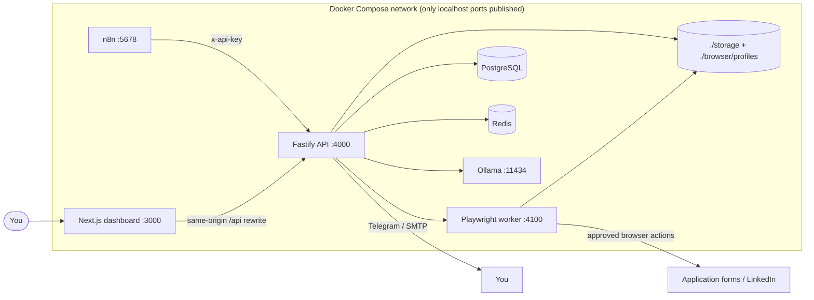

# Vulcaestus


A self-hosted AI job-search platform: discovery, deduplication, evidence-based scoring,
resume tailoring, application preparation, referral ranking, LinkedIn message drafting,
human approval, browser-assisted applications, tracking, follow-ups, interview briefs,
and analytics.

Everything runs on your server. Resumes, jobs, applications, generated messages, screenshots,
and audit logs stay local. AI calls go only to the provider you configure (Ollama by default).

> **Human-in-the-loop is the default.** The agent prepares actions. Nothing is submitted,
> sent, or clicked on an external site without an explicit approval (and, for LinkedIn, a
> manual send by you). `DRY_RUN=true` is the default.

---

## 1. Quick start

### Requirements

- Docker 24+ with Compose v2
- 8 GB RAM minimum (16 GB recommended for a 7B local model)
- Ports `3000`, `4000`, `4100`, `5678`, `11434` free on localhost

### Start

```bash
# 1. Configure secrets (the file is gitignored)
cp .env.example .env
# Generate values for SESSION_SECRET, SECRETS_KEY, SERVICE_API_KEY,
# WEBHOOK_SECRET, BROWSER_WORKER_SECRET, N8N_ENCRYPTION_KEY, POSTGRES_PASSWORD:
openssl rand -base64 32

# 2. Build and start everything
#    `make up` builds images sequentially to avoid exhausting small Docker VMs.
make up

# 3. Wait for health
docker compose ps

# 4. Pull the local model (the ollama-init service also attempts this)
make model
```

If you prefer raw Compose commands, build one service at a time:

```bash
docker compose build api
docker compose build browser-worker
docker compose build web
docker compose up -d
```

Each Dockerfile installs only its own workspace dependency graph, which keeps the web
build within a ~5 GB Docker VM. Next.js is capped at a 3 GB heap.

Open **http://localhost:3000**.

On first launch you are redirected to **`/setup`** and create the admin account. There are no
default credentials.

### First-run checklist

1. Create the admin account at `/setup`.
2. Complete `/profile` — target titles, locations, salary, skills, authorization, limits.
3. Upload a master resume at `/resume` (PDF, DOCX, Markdown, or text).
4. Open `/settings`, click **Add defaults** for job sources, then **Run** next to Remotive.
5. Open `/jobs`, run **Discover jobs**, open a role, and click **Score job**.
6. Click **Prepare application** and review it at `/approvals/applications`.
7. Approve it. With `DRY_RUN=true` the browser action is recorded as **simulated**; nothing is submitted.
8. When you are ready for live browser actions, set `DRY_RUN=false` and restart `api` and `browser-worker`.
9. Optional: import n8n workflows (`make workflows-install`) and activate schedules.
10. Optional: set up a persistent LinkedIn session (section 8) and use `/approvals/linkedin`.

---

## 2. Architecture



### Services

| Service | Responsibility |
|---|---|
| `web` | Next.js dashboard, same-origin `/api/*` proxy to the API |
| `api` | Auth, profiles, resumes, jobs, AI orchestration, approvals, documents, analytics |
| `browser-worker` | Isolated Playwright/Chromium actions with persistent profiles; never auto-sends LinkedIn |
| `postgres` | Primary database (Prisma migrations) |
| `redis` | Reserved for rate-limit/session scale-out (health-checked) |
| `ollama` | Local AI model runtime |
| `n8n` | Scheduled orchestration; calls authenticated internal API endpoints |
| `migrate` | One-shot `prisma migrate deploy` before the API starts |

More detail: [`ARCHITECTURE.md`](./ARCHITECTURE.md).

---

## 3. What is implemented

### Accounts & privacy
- First-run setup, bcrypt password hashing, hashed session tokens in HTTP-only cookies
- `ADMIN` and `USER` roles, admin user management, per-user profile and data isolation
- Private, per-user job catalogs with per-profile deduplication; sources are admin-managed

### Candidate profile
- Personal details, links, summary, years of experience
- Target/alternative titles, countries, cities, work mode, salary, currency, seniority
- Technologies, industries, languages, priority and excluded companies
- Work authorization, authorized countries, sponsorship, relocation
- Scoring thresholds, tailoring threshold, daily application/outreach limits, automation mode

### Resume
- PDF, DOCX, Markdown, TXT upload and local text extraction
- Conservative deterministic section parsing plus optional AI structuring
- Structured JSON stored in PostgreSQL; master resume selection
- Tailored resume generation that filters unsupported companies, skills, and metrics
- PDF, DOCX, and Markdown export; ATS-friendly plain version

### Jobs
- **Private per-user job catalogs** with per-profile deduplication; sources stay admin-managed
- Pluggable sources: Greenhouse, Lever, Remotive, Ashby, Workable, RSS, manual import
- Authorized-partner adapters for Indeed and ZipRecruiter (credentials required)
- Google Jobs via SerpAPI (key required)
- LinkedIn is manual import only; no scraping or anti-bot bypass
- Normalization: remote policy, employment type, seniority, skills, requirements,
  years of experience, salary, sponsorship signals, country
- Deduplication by source/external id, canonical URL, company+title+location fingerprint,
  and title similarity for re-posts
- Deterministic scoring for technical, experience, seniority, location, salary,
  authorization, industry, and preference, optionally refined by AI
- Score recommendations driven by configurable thresholds
- Archive and soft-delete per job, with Archived/Deleted views and restore
- Multi-select bulk actions: score selected, archive, delete, restore, unarchive
- Background bulk scoring with progress, cancellation, and a fast deterministic-only mode
- Collapsible filter panel, saved via URL parameters, plus quick selections for unscored,
  strong matches, apply-range, and jobs without applications

### Applications & approvals
- Application package: tailored resume, cover letter, answers, risk/missing-requirement summary
- Application questions carry a source; sensitive or unknown answers become `HUMAN_REVIEW`
- Unified approval inbox with edit, regenerate, reject, postpone, and bulk approval for safe actions
- Application submissions always require individual approval; bulk approval is limited to outreach/follow-ups
- Every decision is audited and attributable to a user
- Approval gate is enforced again at the browser-worker boundary

### Outreach & referrals
- Manual/CSV contact import; no relationship is inferred
- Deterministic contact ranking plus optional AI explanation
- Seven message types with evidence list and warnings
- "Approve & prepare send": worker opens the profile in a persistent session and screenshots it;
  you press Send and then **Mark sent**
- Daily limits enforced server-side

### Browser automation
- Playwright + Chromium in a separate service
- Persistent browser profiles under `./browser/profiles`
- Fill text fields, textareas, selects; upload resume/cover letter PDFs
- Detect CAPTCHA, login walls, and human-verification pages and stop
- Unknown/unfilled required fields stop the action with a screenshot
- Detect success confirmation, capture reference when available
- Dry-run simulates every action and records what would have happened

### Tracking, follow-ups, interviews, analytics
- 14 application statuses from `DISCOVERED` to `ARCHIVED`
- Configurable follow-up delay; generated messages require approval
- Interview preparation from the job posting and your actual achievements
- Response/interview/offer rates, source/company/role breakdowns, score distribution,
  referral conversion, average response time, daily activity
- Audit log and AI generation log (model, prompt version, inputs by reference, output, latency)

---

## 4. Configuration

All variables live in `.env`. See `.env.example` for the full list.

### Required secrets

| Variable | Purpose |
|---|---|
| `POSTGRES_PASSWORD` | Database password used by Postgres and the API URL |
| `SESSION_SECRET` | Reserved for signing/derivation; sessions are random hashed tokens |
| `SECRETS_KEY` | AES-256-GCM key material for provider/source secrets |
| `SERVICE_API_KEY` | n8n/internal endpoint authentication |
| `WEBHOOK_SECRET` | Webhook authentication |
| `BROWSER_WORKER_SECRET` | API ↔ worker authentication |
| `N8N_ENCRYPTION_KEY` | n8n credential encryption |

Generate each with `openssl rand -base64 32`. Never commit `.env`.

### Safety

| Variable | Default | Meaning |
|---|---|---|
| `DRY_RUN` | `true` | Simulate all external actions; never send/submit |
| `AI_ENABLED` | `true` | Disable AI calls; deterministic fallbacks still run |
| `RATE_LIMIT_MAX` | `300` | Requests per minute per IP |
| `FOLLOWUP_DAYS` | `7` | Days before a follow-up is generated |
| `MAX_JOBS_PER_DAY` | `200` | Discovery cap |
| `MAX_FOLLOWUPS_PER_DAY` | `20` | Follow-up cap |

Daily application/outreach limits are per-profile and enforced in the API.
`SAFE_MODE` is the default automation mode for every new profile.

### AI providers

Default: Ollama `qwen2.5:7b-instruct` at `http://ollama:11434` (Compose) or
`http://localhost:11434` (local dev).

A 7B model needs roughly 8–10 GB of RAM available to the Ollama container. On a smaller
Docker VM (`llama-server ... signal: killed`), either raise Docker Desktop's memory limit or
switch `OLLAMA_MODEL` to `qwen2.5:3b-instruct` or `qwen2.5:1.5b` (both were verified with the
full scoring, tailoring, cover-letter, and answer flows). Deterministic scoring remains
available whenever the model is unavailable.

In **Settings → AI providers** you can add:

- Ollama (any pulled model)
- OpenAI
- Anthropic
- OpenRouter
- OpenCode (OpenAI-compatible)
- Custom OpenAI-compatible endpoint (base URL + model + optional key)

Keys are encrypted with AES-256-GCM and never returned by the API. The provider marked
default is used for all generations; environment values are the fallback when no database
provider exists.

### Notifications

Set `TELEGRAM_BOT_TOKEN` + `TELEGRAM_CHAT_ID` and/or SMTP (`EMAIL_*`). The settings page has a
test button. Dashboard notification records are always written; delivery is best-effort and
failures are stored.

---

## 5. n8n workflows

Nine importable workflows are in [`n8n/workflows`](./n8n/workflows). They call the API's
service-authenticated `/api/internal/*` endpoints.

| Workflow | Schedule |
|---|---|
| `01-job-discovery` | Every 6 hours |
| `02-job-scoring` | Every 2 hours |
| `03-resume-tailoring` | Every 4 hours |
| `04-referral-discovery` | Daily |
| `05-application-preparation` | Every 4 hours |
| `06-application-browser-agent` | Every 30 minutes (retries failed actions with valid approvals) |
| `07-followups` | Daily |
| `08-interview-preparation` | Hourly |
| `09-analytics` | Daily summary notification |

Import via the n8n UI or:

```bash
make workflows-install
```

See [`n8n/README.md`](./n8n/README.md) for environment variables and webhook signatures.

---

## 6. Approval model

```
AI / rules prepare
        ↓
ApprovalRequest (PENDING)
        ↓ edit / regenerate / postpone / reject
        ↓ approve (recorded user + timestamp)
Approved action
        ↓
DRY_RUN=true  → BrowserAction SIMULATED (no external effect)
DRY_RUN=false → BrowserAction queued to Playwright
        ↓
CAPTCHA / login / unknown required field → AWAITING_HUMAN + HUMAN_ACTION approval
        ↓
success confirmation → application SUBMITTED / message ready for manual send
```

The gate is re-checked when a live browser action is dispatched: the approval must be
`APPROVED`, of the expected type, for the same entity, and not expired.

Application submissions are never bulk approved. LinkedIn messages are never sent by the
worker; it prepares the session and returns a human-action task.

---

## 7. Dry-run and automation modes

`DRY_RUN=true` (default) still discovers, scores, tailors, drafts messages, and records
browser actions — but the worker never opens an external site, and the API never submits or
sends. Simulated actions are visible on application pages and in the approval queue.

Per-profile modes:

- `SAFE_MODE` — every external action requires approval (default)
- `ASSISTED_MODE` — low-risk repetitive actions may run automatically; messages and submissions still require approval
- `AUTONOMOUS_MODE` — only explicitly configured categories; application submission remains individually gated in this implementation

---

## 8. LinkedIn persistent session (prepare-and-handoff)

The worker never asks for or stores your password. It uses a persistent Chromium profile:

```bash
# On a machine with a display, from the repo root:
cd apps/browser-worker
pnpm exec playwright install chromium   # once, if running outside Docker
pnpm linkedin:login <profile-uuid>
```

Log in manually, press Enter in the terminal, and the session is saved to
`browser/profiles/<profile-uuid>`, which is bind-mounted into the worker.

When you approve a LinkedIn message, the worker:

1. Opens the contact profile in that persistent session.
2. Detects login walls/CAPTCHAs and stops with a screenshot if present.
3. Leaves the composer to you and creates a **Send prepared message** human action.
4. You send it manually, then click **Mark sent** (or complete the human action).

This stays within LinkedIn's terms and avoids automated sends. With `DRY_RUN=true`, even the
browser navigation is simulated.

---

## 9. API overview

Authentication uses the `vulcaestus_session` HTTP-only cookie. Internal endpoints use
`x-api-key`; webhooks use `x-webhook-secret`; worker callbacks use `x-worker-secret`.

| Area | Endpoints |
|---|---|
| Health | `GET /health`, `GET /ready` |
| Auth | `POST /api/auth/setup`, `/login`, `/logout`, `/password`, `GET /api/auth/me`, `/status` |
| Users | `GET/POST /api/users`, `PATCH/DELETE /api/users/:id` |
| Profile | `GET/PUT /api/profile`, `GET /api/profile/daily-limits` |
| Resumes | `GET/POST /api/resumes`, `GET/PATCH/DELETE /api/resumes/:id`, `POST /api/resumes/:id/structure` |
| Jobs | `GET/POST /api/jobs`, `GET/PATCH/DELETE /api/jobs/:id`, `POST /api/jobs/discover`, `GET /api/jobs/ids`, `POST/DELETE /api/jobs/:id/archive`, `POST /api/jobs/:id/restore`, `POST /api/jobs/bulk`, `POST /api/jobs/score-all`, `GET /api/jobs/batches/:id` |
| Job actions | `POST /api/jobs/:id/score`, `/tailor`, `/cover-letter`, `/prepare`, `/referrals`, `/outreach` |
| Applications | `GET /api/applications`, `GET/PATCH/DELETE /api/applications/:id`, `POST /:id/answers`, `PATCH /:id/answers/:answerId`, `POST /:id/request-approval`, `GET /:id/timeline` |
| Approvals | `GET /api/approvals`, `GET /:id`, `POST /:id/approve`, `/reject`, `/postpone`, `/regenerate`, `PATCH /:id`, `POST /api/approvals/bulk-approve` |
| Contacts | `GET/POST /api/contacts`, `PATCH/DELETE /api/contacts/:id`, `POST /api/contacts/import`, `/rank` |
| Outreach | `GET/POST /api/outreach`, `GET/PATCH/DELETE /api/outreach/:id`, `POST /:id/regenerate`, `/request-approval`, `/mark-sent` |
| Interviews | `GET/POST /api/interviews`, `GET/PATCH/DELETE /api/interviews/:id`, `POST /:id/prepare` |
| Follow-ups | `GET /api/followups`, `POST /api/followups/run`, `POST /:id/request-approval`, `PATCH/DELETE /:id` |
| Analytics | `GET /api/analytics/summary`, `/activity`, `/sources` |
| Settings | `GET/PUT /api/settings`, sources, providers, prompts, notifications |
| Documents | `GET /api/documents/resume/:id?format=pdf|docx|md`, same for tailored and cover letter |
| Webhooks | `POST /api/webhooks/{job-created,job-approved,application-approved,linkedin-message-approved,referral-approved,followup-approved,human-action-complete}` |
| Internal (n8n) | `POST /api/internal/jobs/discover`, `/jobs/ingest`, `/jobs/score-batch`, `/jobs/tailor-batch`, `/applications/prepare-batch`, `/referrals/rank`, `/interviews/prepare-upcoming`, `/browser-actions/retry`, `/followups/run`, `/notify`, `GET /api/internal/analytics/summary` |

---

## 10. Testing

```bash
pnpm install
pnpm --filter @vulcaestus/db generate
pnpm test            # API + AI unit tests
pnpm typecheck       # all packages and apps
make workflows-validate
```

Covered by tests:

- JSON extraction from messy model output (fences, prose, trailing commas)
- Prompt parsing/rendering and versioning
- Job normalization, URL canonicalization, stable fingerprints
- Duplicate detection: external id, canonical URL, similarity, false-positive guard
- Deterministic scoring: strong match, exclusions, experience gaps, sponsorship, unknown salary
- Resume extraction without fabrication
- Sensitive application questions and insufficient-evidence answers
- Approval gate: pending/mismatched/expired approvals blocked; dry-run allowed
- Live external actions refused without an approved matching record

Integration testing against a real database is available by running the stack and exercising
the API; the approval and duplicate tests intentionally use pure functions so they run without
infrastructure.

---

## 11. Adding a job source

1. Add the kind to `JobSourceKind` in `packages/database/prisma/schema.prisma` (only if it is a
   new category; most sources can reuse `RSS` or an authorized partner adapter).
2. Create a migration: `pnpm --filter @vulcaestus/db exec prisma migrate dev --name add_source_kind`.
3. Add an adapter function in `apps/api/src/services/jobs/sources.ts` that returns `JobInput[]`.
4. Add it to `runSource()`.
5. Expose the kind in the Settings source type list.
6. If it needs credentials, read them with `configString(config, 'apiKey')`; values are encrypted
   at rest when saved through the Settings API.
7. Respect the site's terms, robots policy, rate limits, and authentication. Do not add
   CAPTCHA/anti-bot bypasses.

Prefer official APIs. For sites without an authorized API, use manual import and the browser
capture boundary rather than scraping.

---

## 12. Adding an AI model/provider

- **Same provider, different model:** Settings → AI providers → add/test, or set
  `OLLAMA_MODEL` and restart.
- **OpenAI-compatible provider:** choose `Custom OpenAI-compatible`, set base URL, model,
  and optional key.
- **New native protocol:** implement the `AiProvider` interface in
  `packages/ai/src/providers.ts`, add the kind to `AiProviderKind`, and return it from
  `createProvider()`.
- Every generation records model, prompt version, input references, output, and latency in
  `AiGeneration`; prompt overrides are versioned in `Prompt`.

The AI is advisory. Deterministic scoring always computes evidence-derived matches and
missing requirements. Tailoring sanitizes generated content against the master resume.

---

## 13. Adding a browser automation target

1. Add a kind to `BrowserActionKind` if necessary.
2. Implement a `run<Action>()` function in `apps/browser-worker/src/actions.ts` using
   Playwright. Always call `detectHumanChallenge()` after navigation.
3. Return `AWAITING_HUMAN` with a screenshot for anything unfamiliar.
4. Dispatch it from `apps/api/src/services/browser.ts` with an approval id and expected type.
5. Handle the callback in `apps/api/src/routes/internal.ts` (status → domain state).
6. Never accept passwords. Use persistent profiles.
7. Never click a final “send” on LinkedIn; return a human action instead.

---

## 14. Known limitations

- **Application forms are heterogeneous.** The worker handles labels, placeholders, selects,
  and file inputs heuristically. Custom widgets, multi-step forms, or unknown required fields
  stop for human review. This is deliberate.
- **LinkedIn is prepare-and-handoff.** No scraping, login automation, or automated sends.
- **Indeed, Google Jobs, ZipRecruiter** require authorized partner/API credentials. Without
  them the source reports a clear error; manual import always works.
- **Company research is not performed.** Interview briefs state when research was not supplied
  and never invent company facts.
- **Email delivery** requires SMTP; otherwise follow-ups become human tasks.
- **PDF text extraction** depends on a text-based PDF. Scanned resumes need OCR first.
- **AI quality** depends on the model. A 7B local model is usable for drafting but less precise
  than larger hosted models; all outputs remain reviewable.
- **Single-node design.** Redis is present but not required for one API instance. Horizontal
  scaling would need shared session/rate-limit state and worker queue coordination.
- **No automated submission in this build.** Application approval dispatches the worker, but
  the UI and docs assume a human reviews the result. `AUTONOMOUS_MODE` does not bypass the gate.

---

## 15. Troubleshooting

| Symptom | Fix |
|---|---|
| `docker compose up` fails on `.env` | `cp .env.example .env` and replace secrets |
| API unhealthy | `docker compose logs api`; check `migrate` completed and `DATABASE_URL` |
| AI returns deterministic fallbacks | `docker compose exec ollama ollama list`; pull the model; test in Settings. If Ollama logs `signal: killed`, raise Docker memory to 10–12 GB or use `qwen2.5:3b-instruct`/`qwen2.5:1.5b`. |
| Browser worker fails to launch | `docker compose logs browser-worker`; image must match Playwright 1.49.1 |
| Captcha/human action | Expected. Open the URL/screenshot, complete it manually, then resolve the approval |
| LinkedIn login wall | Create the persistent session with `pnpm linkedin:login <profile-id>` |
| No jobs discovered | Add a source and run it; check `lastError` in Settings |
| Screenshot 404 | Ensure `./storage` is mounted and the action finished |
| n8n cannot read env | Keep `N8N_BLOCK_ENV_ACCESS_IN_NODE=false`; import workflows with active API URL |

Logs are structured JSON from the API and worker. Set `LOG_LEVEL=debug` for more detail.

---

## 16. Security

See [`SECURITY.md`](./SECURITY.md). Highlights: localhost-bound ports, no default credentials,
bcrypt passwords, hashed session tokens, origin-checked mutations, rate limiting, AES-GCM
encrypted provider/source keys, service-secret internal endpoints, approval-gated external
actions, and a full audit log.

## 17. License

Private self-hosted project. Add a license before distributing.
